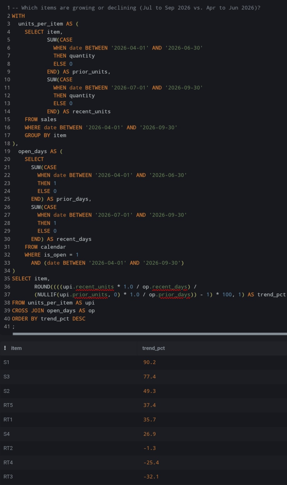
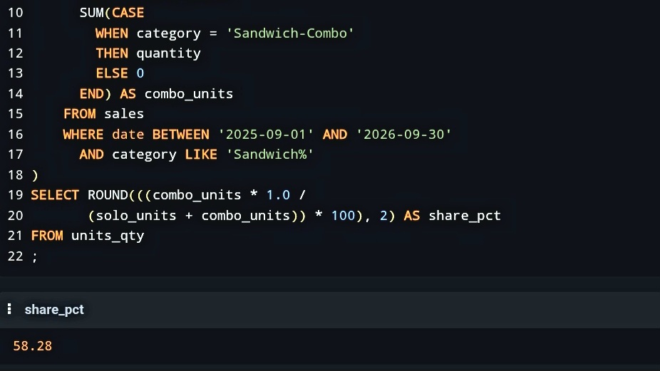

# SQL Menu Performance Analysis

**Question:** Which items should be added to the 2027 new store menu?

**Data note:** Figures are scaled to protect the owner's financial information. Rankings, trends and shares reflect the real patterns.

## Tools
SQL (SQLite)

## Tables
- `sales`: daily item sales
- `items`: item, category, launch date
- `calendar`: open days (Mon to Sat, closures removed)

## Queries and Results
| # | Question | Result |
|---|----------|--------|
| 1 | Total sales per category | [one-line result] |
| 2 | Top items by units | [one-line result] |
(continue to 10)

## Excel vs. SQL Check

I compared my SQL results with the Excel Item Summary. The numbers match, which confirms both are correct.

| Metric | Excel | SQL | Match |
|--------|-------|-----|-------|
| Units per item | [value] | [value] | Yes |
| Average daily units per item | [value] | [value] | Yes |
| Days with sales per item | [value] | [value] | Yes |
| Zero-sale days | [value] | 37 | Yes |
| Trend (S1) | [value] | +90.2% | Yes |

## Highlights

### 1. Trend: which items are growing?
Jul to Sep 2026 vs. Apr to Jun 2026, based on average daily units. S1 (+90.2%), S3 (+77.4%) and S2 (+49.3%) grew the most. RT3 (-32.1%) and RT4 (-25.4%) declined the most.

### 2. Zero-sale days
37 open days had no sales between Sep 1, 2025 and Sep 30, 2026. This uses a LEFT JOIN between the calendar and sales tables.

### 3. Overload value: RT5 vs. RT1 to RT4
RT5 sold about 202% more units than the average of RT1 to RT4, which makes it the strongest rice topper candidate.

### 4. Combo vs. solo sandwiches
Combos made up 58.28% of sandwich units, so customers choose the combo more often than the solo.

## Limitations
- 

## Files
- `create-table.sql`: create and insert queries
- `queries.sql`: question queries
