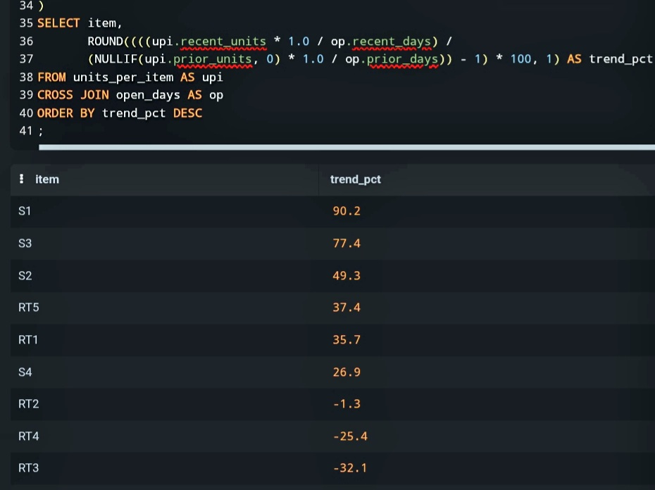

# SQL Menu Performance Analysis

**Question:** Which items should be added to the 2027 new store menu?

**Data note:** Figures are scaled to protect the owner's financial information. Rankings, trends and shares reflect the real patterns.

## Tools
SQL (SQLite)

## Tables
- `sales`: daily item sales
- `items`: item, category, launch date
- `calendar`: open days (Mon to Sat, closures removed)

## Queries and Results

| # | Question | Result |
|---|----------|--------|
| 1 | What are the total sales per category? | [one-line result] |
| 2 | Which items sold the most units? | [one-line result] |
| 3 | What are the total sales per month? | [one-line result] |
| 4 | How many open days are in the window? | [one-line result] |
| 5 | What is the average daily units per item? | [one-line result] |
| 6 | How many days did each item have sales (consistency)? | [one-line result] |
| 7 | How many open days had zero sales? | 37 days |
| 8 | Which items are growing or declining (Jul to Sep 2026 vs. Apr to Jun 2026)? | S1 grew the most (+90.2%). RT3 declined the most (-32.1%). |
| 9 | Do customers choose the combo (sandwich w/ fries) over the solo sandwich? | Combos made up 58.28% of sandwich units. |
| 10 | How does RT5(Overload) compare with the average of RT1 to RT4? | RT5 sold about 202% more units. |

## Excel vs. SQL Check

I compared my SQL results with the Excel Item Summary. The numbers match, which confirms both are correct.

| Metric | Excel | SQL | Match |
|--------|-------|-----|-------|
| Units per item | [value] | [value] | Yes |
| Average daily units per item | [value] | [value] | Yes |
| Days with sales per item | [value] | [value] | Yes |
| Zero-sale days | [value] | 37 | Yes |
| Trend (S1) | [value] | +90.2% | Yes |

## Highlights

### 1. Trend: Which items are growing?
Jul to Sep 2026 vs. Apr to Jun 2026, based on average daily units. S1 (+90.2%), S3 (+77.4%) and S2 (+49.3%) grew the most. RT3 (-32.1%) and RT4 (-25.4%) declined the most.

### 2. Zero-sale days
37 open days had no sales between Sep 1, 2025 and Sep 30, 2026. This uses a LEFT JOIN between the calendar and sales tables.

### 3. Overload value: RT5 vs. RT1 to RT4
RT5 sold about 202% more units than the average of RT1 to RT4, which makes it the strongest rice topper candidate.

### 4. Combo vs. solo sandwiches
Combos made up 58.28% of sandwich units, so customers choose the combo more often than the solo.

## Limitations
- Items were ranked by sales performance, not profit.
- Shorter rice topper history: Rice toppers launched in September 2025, so they have less history than sandwiches. Their early trend may include launch ramp-up.
- Franchised Business influence: The franchised business sales may affect KSimple items sales (for example, add-on purchases). This could not be measured.
- Results are candidates for the 2027 menu. Ingredient availability, prep time, and owner feedback also matter
- Figures are scaled for confidentiality.

## Files
- `create-table.sql`: create and insert queries
- `queries.sql`: question queries
