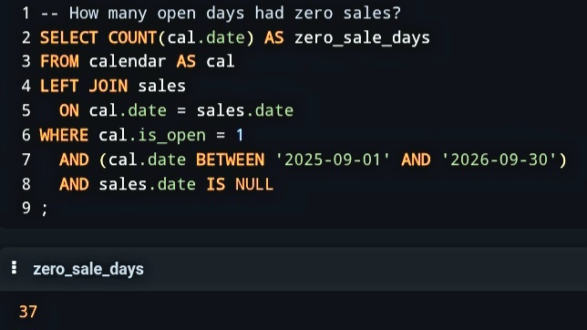
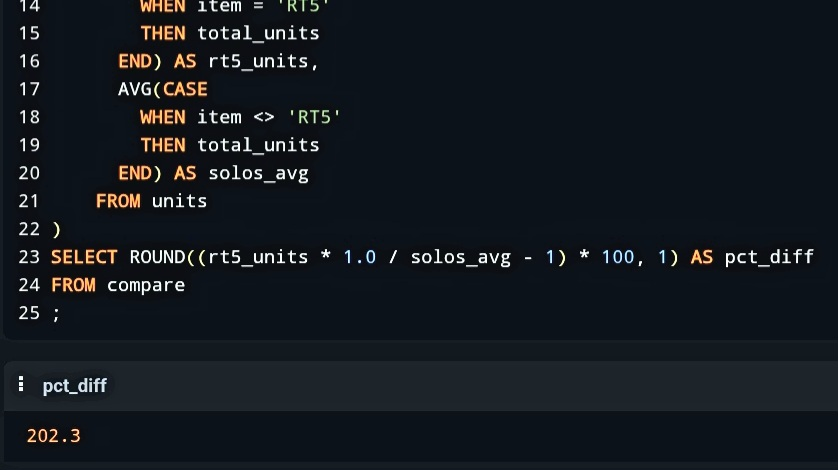

> **Part 2 of 3** in the Menu Performance Analysis for 2027 Store Planning. See also: [Part 1: Excel Menu Performance Analysis](https://github.com/joserodrigodiga/excel-menu-performance-analysis) | Part 3: Looker Studio dashboard (in progress)

# SQL Menu Questions

**Question:** Which items should be added to the 2027 new store menu?

**Data note:** Figures are scaled to protect the owner's financial information. Rankings, trends and shares reflect the real patterns.

## Tools
SQL (SQLite)

## Tables
- `sales`: daily item sales
- `items`: item, category, launch date
- `calendar`: open days (Mon to Sat, closures removed)

## Queries and Results

| # | Question | Result |
|---|----------|--------|
| 1 | What are the total sales per category? | Sandwich-Combo led with 136,995 (39% of sales). RiceTopper-Mix was second at 84,185. |
| 2 | Which items sold the most units? | S4 sold the most (1,384 units), then RT5 (1,096) and S2 (1,063). RT2 sold the least (108). |
| 3 | What are the total sales per month? | Sales peaked in Jul 2026 (39,535) and Jan 2026 (39,410). Sep 2025 was the lowest (16,165). |
| 4 | How many open days are in the window? | 339 open days (Sep 1, 2025 to Sep 30, 2026). |
| 5 | What is the average daily units per item? | S4 led at 4.08 units per open day, then RT5 (3.23) and S2 (3.14). RT2 was lowest (0.32). |
| 6 | What share of open days did each item have sales (consistency)? | S4 sold on 55.16% of open days. S2 and RT5 followed at 42.48%. RT2 was lowest at 6.78%. |
| 7 | How many open days had zero sales? | 37 days |
| 8 | Which items are growing or declining (Jul to Sep 2026 vs. Apr to Jun 2026)? | S1 grew the most (+90.2%). RT3 declined the most (-32.1%). |
| 9 | Do customers choose the combo (sandwich w/ fries) over the solo sandwich? | Combos made up 58.28% of sandwich units. |
| 10 | How does RT5(Overload) compare with the average of RT1 to RT4? | RT5 sold about 202% more units. |

## Excel vs. SQL Check

I compared my SQL results with the Excel calculations. The numbers match, which confirms both are correct.

| Metric | Excel | SQL | Match |
|--------|-------|-----|-------|
| Total sales | 349,490 | 349,490 (sum of Q1) | Yes |
| Units sold | 5,753 | 5,753 (sum of Q2) | Yes |
| Average daily sales | 1,030.94 | 349,490 ÷ 339 = 1,030.94 | Yes |
| Zero-sale days % | 10.9% | 37 ÷ 339 = 10.9% | Yes |
| Average daily units (S4) | 4.08 | 4.08 | Yes |

## Highlights

### 1. Trend: Which items are growing?
Jul to Sep 2026 vs. Apr to Jun 2026, based on average daily units. S1 (+90.2%), S3 (+77.4%) and S2 (+49.3%) grew the most. RT3 (-32.1%) and RT4 (-25.4%) declined the most.

### 2. Zero-sale days
37 open days had no sales between Sep 1, 2025 and Sep 30, 2026. This uses a LEFT JOIN between the calendar and sales tables.

### 3. Overload value: RT5 vs. RT1 to RT4
RT5 sold about 202% more units than the average of RT1 to RT4, which makes it the strongest rice topper candidate.

### 4. Combo vs. solo sandwiches
Combos made up 58.28% of sandwich units, so customers choose the combo more often than the solo.

## Limitations
- No cost data: Items were ranked by sales performance, not profit.
- Data period: Sales end Sep 30, 2026. Items were compared from Sep 1, 2025, when all 9 were on the menu.
- Shorter rice topper history: Rice toppers launched in September 2025, so they have less history than sandwiches. Their early trend may include launch ramp-up.
- Store operations: Sundays and owner-confirmed closures were excluded. Days with no recorded sales were counted as open days with zero sales.
- Franchise influence: Sales of the franchised brand may affect these items' sales (for example, add-on purchases). This could not be measured.
- Candidates, not final decisions: Results are candidates for the 2027 menu, pending margin review, owner feedback, prep time, and ingredient availability.
- Figures are scaled to protect business data.

## Files
- `create-tables.sql`: create and insert queries
- `queries.sql`: question queries
